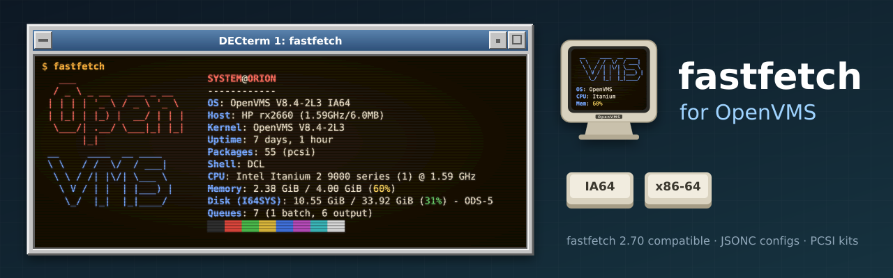

<p align="center">
  
</p>

# vms-fastfetch

A [fastfetch](https://github.com/fastfetch-cli/fastfetch)-compatible system information tool for
OpenVMS (x86-64 and IA64), built natively with VSI C.

## Screenshots

Copied from the terminal; the colours, and the two rows of colour blocks at the end,
don't survive a copy. Node names and addresses are replaced.

**IA64:** an HP rx2660 running OpenVMS V8.4-2L3

```text
$ fastfetch
   ___                       SYSTEM@NODE1
  / _ \ _ __   ___ _ __      ------------
 | | | | '_ \ / _ \ '_ \     OS: OpenVMS V8.4-2L3 IA64
 | |_| | |_) |  __/ | | |    Host: HP rx2660 (1.59GHz/6.0MB)
  \___/| .__/ \___|_| |_|    Kernel: OpenVMS V8.4-2L3
       |_|                   Uptime: 7 days, 12 hours, 3 mins
 __     ____  __ ____        Packages: 56 (pcsi)
 \ \   / /  \/  / ___|       Shell: DCL
  \ \ / /| |\/| \___ \       Terminal: FTA966: (pseudo-terminal) VT500 series
   \ V / | |  | |___) |      CPU: Intel Itanium 2 9000 series (1) @ 1.59 GHz
    \_/  |_|  |_|____/       Memory: 2.34 GiB / 4.00 GiB (59%)
                             Page file: 0 B / 4.05 GiB (0%)
                             Disk (I64SYS): 10.57 GiB / 33.92 GiB (31%) - ODS-5
                             Local IP (WE1): 10.0.0.5/24
                             DNS: 10.0.0.1
                             Queues: 7 (1 batch, 6 output)
                             Locale: C (ENGLISH)
```

**x86-64:** a KVM guest running OpenVMS E9.2-4

```text
$ fastfetch
   ___                       SYSTEM@NODE2
  / _ \ _ __   ___ _ __      ------------
 | | | | '_ \ / _ \ '_ \     OS: OpenVMS E9.2-4 x86_64
 | |_| | |_) |  __/ | | |    Host: QEMU Standard PC (Q35 + ICH9, 2009)
  \___/| .__/ \___|_| |_|    Kernel: OpenVMS E9.2-4
       |_|                   Uptime: 7 days, 17 hours, 59 mins
 __     ____  __ ____        Packages: 71 (pcsi)
 \ \   / /  \/  / ___|       Shell: DCL
  \ \ / /| |\/| \___ \       Terminal: FTA1966: (pseudo-terminal) VT500 series
   \ V / | |  | |___) |      CPU: Intel(R) Celeron(R) J4005 (2) @ 2.00 GHz
    \_/  |_|  |_|____/       Memory: 4.53 GiB / 7.10 GiB (64%)
                             Page file: 0 B / 472.88 MiB (0%)
                             Disk (X86SYS): 20.22 GiB / 21.46 GiB (94%) - ODS-5
                             Disk (TOOLS): 408.38 MiB / 964.12 MiB (42%) - ODS-5
                             Disk (SYSDUMP): 9.54 GiB / 16.00 GiB (60%) - ODS-5
                             Local IP (IE0): 10.0.0.6/24
                             DNS: 10.0.0.1
                             Queues: 4 (2 batch, 2 output), 2 jobs
                             Locale: C (ENGLISH)
```

## Install

Download the kit for your platform from the
[latest release](https://github.com/issinoho/vms-fastfetch/releases/latest), restore its
record format (a download through a non-VMS system loses it), and install it:

```
$ SET FILE/ATTRIBUTE=(RFM:FIX,LRL:8192,MRS:8192,RAT:NONE) ISSINOHO-*-FASTFETCH-*.PCSI
$ PRODUCT INSTALL FASTFETCH /PRODUCER=ISSINOHO /SOURCE=dev:[dir]
$ @SYS$STARTUP:FASTFETCH$STARTUP.COM            ! also add to SYSTARTUP_VMS.COM
$ @FASTFETCH$ROOT:[000000]FASTFETCH$SETUP.COM    ! in LOGIN.COM: defines FASTFETCH
$ fastfetch
```

`fastfetch -c all` shows every module, `fastfetch --list-modules` lists them, and
[docs/CONFIG.md](docs/CONFIG.md) covers configuration.

## About

This is not a port. Upstream fastfetch needs a C23 compiler and GCC cleanup attributes, which
VSI C does not have (see [docs/DECISIONS.md](docs/DECISIONS.md), D0). vms-fastfetch is a C99
rewrite that follows fastfetch's design and keeps its interface: the same module names and
default layout, JSONC config, format strings, `--format json` and logo format. Its data comes
from OpenVMS system services (`$GETSYI`, `$GETJPI`, `$GETDVI`, `$GETRMI`, `$DEVICE_SCAN`) where
fastfetch reads /proc and sysfs.

## Status

| Phase | IA64 (V8.4-2L3) | x86-64 (E9.2-4) |
|-------|-----------------|-----------------|
| 0. Scaffold and probes (`tools/probe.sh`) | done | done |
| 1. Core engine + Title/OS/Host/Kernel/Uptime/Colors; `tools/test.sh` 21/21 | done | done |
| 2. CPU, Memory, Page file, Disk, LocalIp, Packages, Shell, Terminal, Processes, Users, Locale, DateTime, Version, Cluster; `tools/test.sh` 38/38 | done | done |
| 3. JSONC config, presets, format strings, `--format json`, `--gen-config`; `tools/test.sh` 68/68 | done | done |
| 4. PCSI kit `ISSINOHO <base> FASTFETCH V0.1-0` (`tools/kit.sh`); install check: install, smoke 8/8, clean removal (`tools/installcheck.sh`) | done | done |
| 5. CPUUsage, Loadavg (instantaneous), DNS, Command (DCL), Queues; kit V0.2-0 install-checked; `tools/test.sh` 78/78 | done | done |

The probe findings that shape the detection code are in [docs/PROBES.md](docs/PROBES.md).

## Workflow

```sh
cp tools/nodes.conf.example tools/nodes.conf   # then fill in the real nodes
tools/build.sh <ia64|x86> [ALL|CLEAN]          # push and build with MMS -> [.BIN_<arch>]FASTFETCH.EXE
tools/test.sh <node>                           # regression checks (log-file output)
tools/run.sh <node> [args]                     # run in an interactive terminal session (colours, $QIO)
python3 tools/gen_logos.py                     # after changing src/logo/ (output committed)
python3 tools/gen_mms.py                       # after adding/removing sources (output committed)
python3 tools/gen_images.py                    # docs/images banner and icon (output committed)
tools/kit.sh <node>                            # PCSI kit -> out/kits/ (producer ISSINOHO)
tools/installcheck.sh <node>                   # install kit, smoke-test, remove (changes the system)
tools/probe.sh <node>                          # Phase 0 probes -> out/probes-<node>.log
tools/vms.sh <node> dcl '<cmd>' ...            # run DCL; also put/get/run/batch
```

Installed from the kit (`PRODUCT INSTALL FASTFETCH`), it is set up with
`@SYS$STARTUP:FASTFETCH$STARTUP.COM` (at boot) and `@FASTFETCH$ROOT:[000000]FASTFETCH$SETUP.COM`
(per user); see `vms/kit/readme.vms`.  From a build tree, define a foreign command:

```
$ fastfetch :== $DISK$USER:[USERNAME.VMS_FASTFETCH.BIN_X86_64]FASTFETCH.EXE
$ fastfetch
$ fastfetch -s os:host:uptime -l vms_small
```

Options and module names are case-insensitive, because DCL upper-cases unquoted arguments.
fastfetch's config files, presets (`-c all`, `-c ci`), format strings and `--format json`
work as upstream; see [docs/CONFIG.md](docs/CONFIG.md).

## Layout

| Path | What |
|------|------|
| `src/` | the program. `src/3rdparty/yyjson` is yyjson 0.13.0, unmodified. |
| `vms/` | VMS build procedures, compiler flags, PCSI kit and DCL smoke test |
| `probes/` | Phase 0 probe programs and `PROBE.COM` |
| `presets/` | presets for `-c <name>` (`all`, `ci`) |
| `tests/` | config files used by `tools/test.sh` |
| `tools/` | host-side scripts (bash, run from WSL/Linux) |
| `docs/` | decisions, probe results, development log, configuration guide, images |

## Artwork

`docs/images/banner.svg` and `docs/images/icon.svg` were made for this project in the style of
classic DECwindows and VT terminals, and are generated by `tools/gen_images.py` from the
program's own logo. The banner shows a sample run with a made-up node name.

OpenVMS is a trademark of VMS Software, Inc. This project is not affiliated with VMS
Software, Inc. or with the fastfetch project.

## Licence

MIT; see [LICENSE](LICENSE). Design, module names, config format and logos follow fastfetch
(MIT), and yyjson is bundled (MIT); see [NOTICE](NOTICE).
